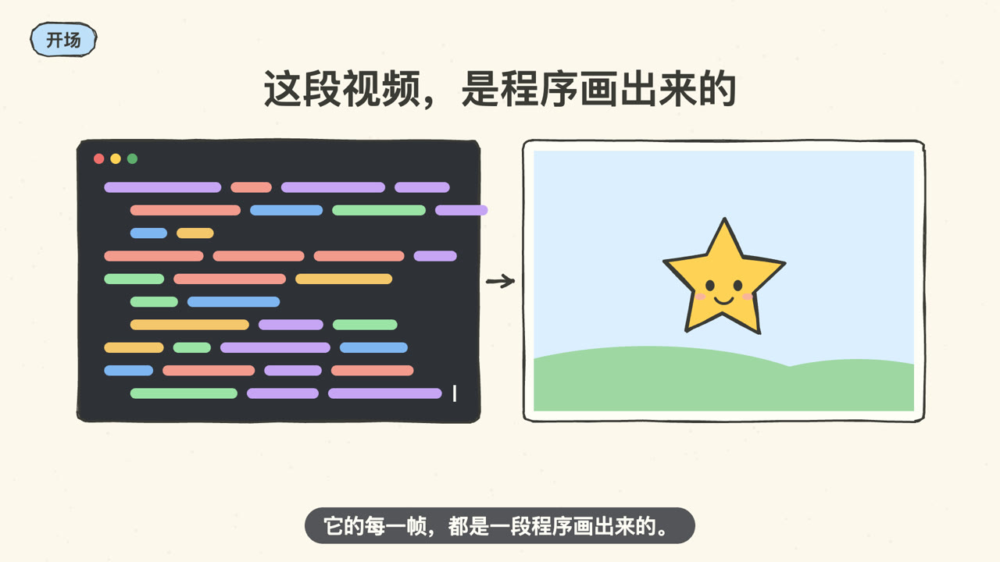

# Example: "How AI Makes Video with Code" (53 s demo)

A complete project produced by following the [`code-driven-video`](../../skills/code-driven-video/SKILL.md) skill. The video explains its own pipeline in 6 scenes: hook → video = frames → `frame = f(t)` → narration as clock → freeze-time capture → three determinism rules.

[](./demo.mp4)

▶️ [Watch `demo.mp4`](./demo.mp4) (1920×1080, 30 fps, 53 s, ~7.5 MB)

## Files

| File | Skill step | Role |
|:---|:---|:---|
| `STORYBOARD.md` | 1 Plan | Global style rules + shot list |
| `script.json` | 1 Plan | Narration lines, grouped by scene |
| `tts.mjs` | 4 Audio | TTS per line → measures durations → writes `timeline.js` and `mix.wav` (narration + code-synthesized SFX) |
| `timeline.js` | 4 Audio | Generated timing data the page reads (committed so the page works without re-running TTS) |
| `index.html` | 2–3 Visuals & Motion | Canvas 2D, hand-drawn style with seeded line boil; exposes `window.__duration` / `window.__seek(t)` |
| `render.cjs` | 5–6 Capture & Review | Puppeteer frame capture (one browser per worker) or review stills |

## Reproduce

Requirements: Node.js 18+, FFmpeg, Puppeteer (`npm i -g puppeteer`). Run in this directory:

```bash
# 1. Narration + timeline. Uses Gemini TTS if GEMINI_API_KEY is in .env, otherwise macOS `say`
node tts.mjs                       # or: node tts.mjs --provider say

# 2. Review stills before the full render (the agent inspects these as images)
NODE_PATH=$(npm root -g) node render.cjs --stills 6.5,14,24,31,39,51

# 3. Full render
NODE_PATH=$(npm root -g) node render.cjs --fps 30 --workers 6

# 4. Mux. Pad audio to the full length instead of using -shortest
DUR=$(node -e "global.window={};require('./timeline.js');console.log(TIMELINE.duration)")
ffmpeg -y -framerate 30 -i frames/%06d.png -i mix.wav -af apad -t $DUR \
  -c:v libx264 -pix_fmt yuv420p -crf 18 -c:a aac -b:a 192k out.mp4
```

The committed `demo.mp4` used macOS `say` (voice: Tingting) for narration, so the voice is functional rather than polished. Swap in a better TTS by adding a key to `.env`. `.env` is git-ignored.

## Lessons learned from this run (already folded back into the skill)

- **Review stills catch real bugs.** A mascot rendered with permanently closed eyes (a default-parameter bug) was spotted on the contact sheet before the full render.
- **Don't parallelize with tabs.** Background tabs in one browser never fire `requestAnimationFrame`, so `__seek` hung until the protocol timed out. One browser per worker fixed it: 1,595 frames in about 18 s.
- **Don't use `-shortest`.** The narration mix ended at the last word and cut off the video's final 1.1 s. Use `apad` with `-t <duration>`.
- **Determinism verified.** Frames re-rendered in isolation are byte-identical (same MD5) to the same frames from the parallel full render.
