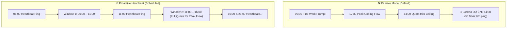

# Maximizing the Codex & Claude Code 5-Hour Rolling Quota Window

> **TL;DR**: The usage quota for tools like OpenAI Codex and Anthropic Claude Code is calculated on a **5-hour rolling window** that begins only when you send your first message. By using a lightweight scheduled job (cron or automation) to ping the assistant at fixed daily intervals, you can align quota resets with your working hours and avoid hitting unexpected rate limits mid-flow.

---

## The Problem

When coding with AI agents, hitting the flow state is magical: ideas materialize into code, context accumulates, and velocity peaks.

Then out of nowhere, you hit the wall:
> *"You've reached your usage limit. Try again in 5 hours."*

Your momentum collapses, forcing an abrupt break right in the middle of active development.

---

## How It Works

The rate limit is not tied to a static calendar schedule. Instead, it operates on a **dynamic 5-hour rolling window**:

1. The 5-hour timer starts **the exact moment you send your first prompt**.
2. If left to chance, the timer typically starts when you begin your morning or afternoon work session.
3. Consequently, the window runs out right when your work hits its peak 2–4 hours later, locking you out until the full 5 hours elapse.



**Core Insight**: Since the start time is dictated by the first ping, we can proactively control when that window opens. By automatically triggering a heartbeat message on a predetermined schedule, we anchor the 5-hour windows directly to our daily routine.

---

## The Solution

Set up a scheduled task to send a minimal trigger message every 5 hours.

### Recommended Daily Schedule (Standard Workday)

| Trigger Time | Active Window Covered | Notes |
| :--- | :--- | :--- |
| **06:00** | 06:00 – 11:00 | Ready before morning kickoff |
| **11:00** | 11:00 – 16:00 | Refreshes quota for the afternoon stretch |
| **16:00** | 16:00 – 21:00 | Covers late afternoon and early evening sessions |
| **21:00** | 21:00 – 02:00 | Covers late-night coding flow |

With this setup, the assistant is constantly placed inside a fresh 5-hour allowance across the entire **06:00 – 02:00** waking window.

---

## Implementation Options

### Option 1: Built-in Platform Automations (e.g. Antigravity)

If your environment supports background agent automations (e.g., Antigravity `/automation` or cron scheduler):
- **Schedule**: Recurring cron expression `0 6,11,16,21 * * *`
- **Prompt**: `"ping"` (Content is irrelevant, only the timing matters).

### Option 2: System Cron (`crontab`) + CLI Ping

If you interact via CLI tools (such as Claude Code or Codex CLI wrappers):

1. **Create a minimal ping script** (`~/.local/bin/agent-heartbeat.sh`):

```bash
#!/usr/bin/env bash
# agent-heartbeat.sh - Minimal quota window heartbeat ping

# For Claude Code CLI:
if command -v claude >/dev/null 2>&1; then
    claude -p "ping" --non-interactive >/dev/null 2>&1
fi

# For OpenAI API / Codex endpoint:
if [ -n "$OPENAI_API_KEY" ]; then
    curl -s https://api.openai.com/v1/models \
        -H "Authorization: Bearer $OPENAI_API_KEY" >/dev/null 2>&1
fi
```

2. **Make it executable**:
```bash
chmod +x ~/.local/bin/agent-heartbeat.sh
```

3. **Configure system `crontab`**:
```cron
# Trigger a ping at 06:00, 11:00, 16:00, and 21:00 daily
0 6,11,16,21 * * * ~/.local/bin/agent-heartbeat.sh >/dev/null 2>&1
```

---

## Key Takeaways

- Quota windows are rolling and triggered by the first interaction.
- Proactively trigger windows to align with your personal productive hours.
- Schedule: `06:00 / 11:00 / 16:00 / 21:00`.
- **The content of the ping does not matter—only the timestamp.**

---

*Reference: Adapted from industry best practices on AI developer tooling rate limit management.*
